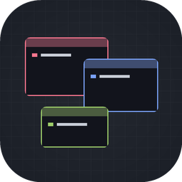
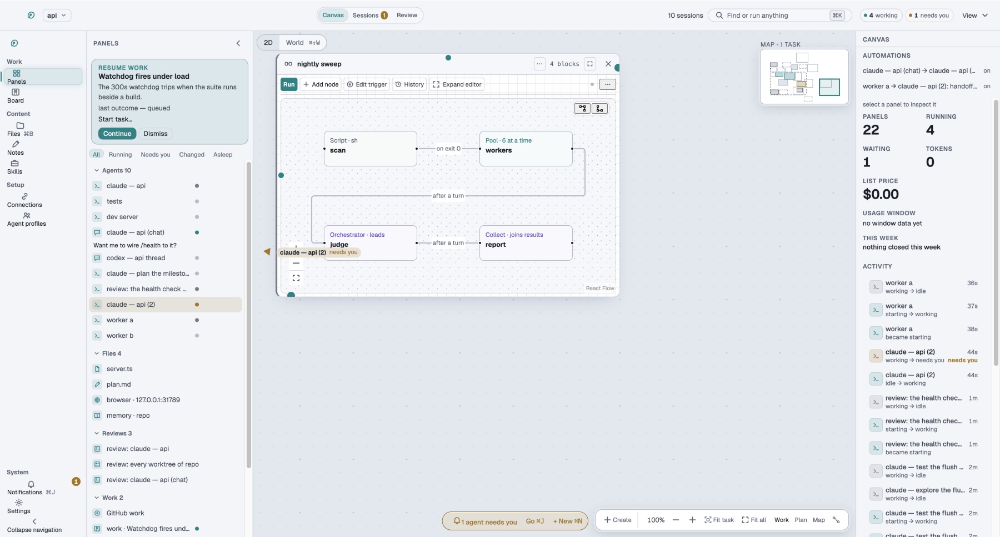
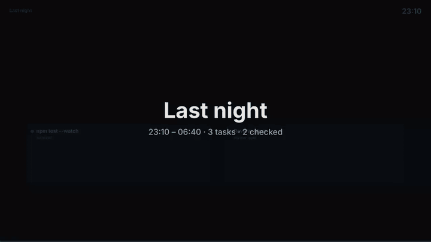
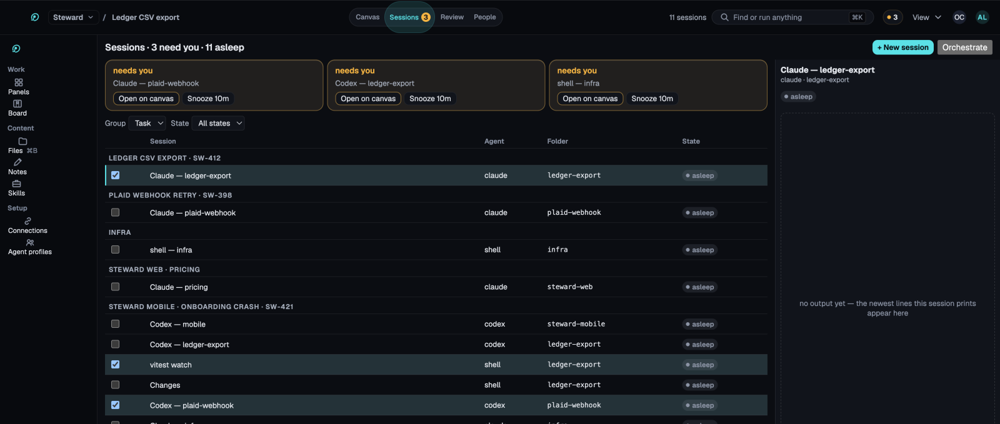
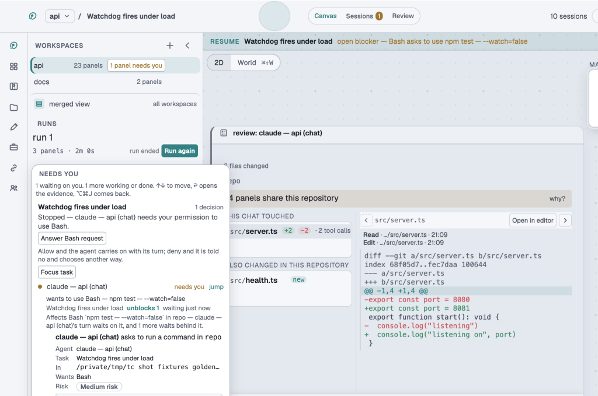
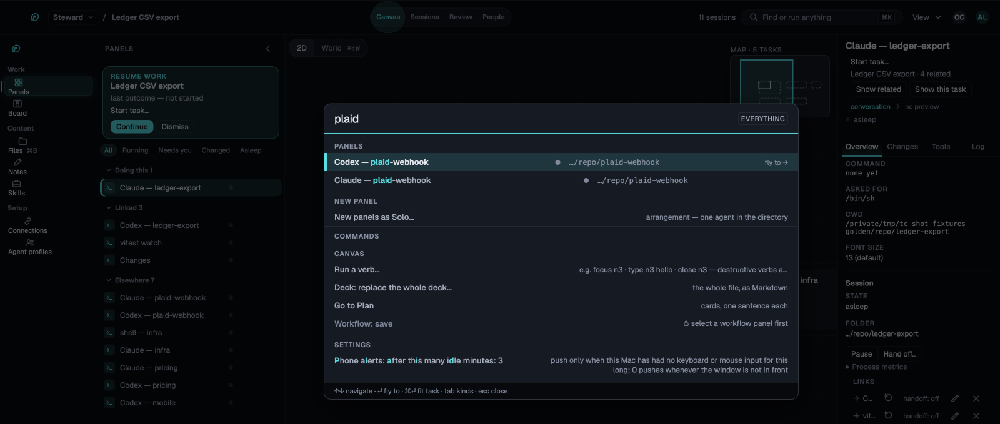
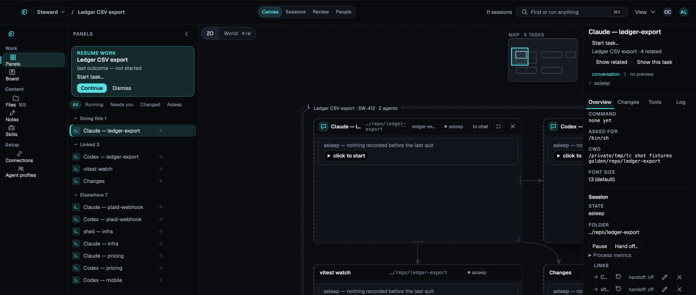
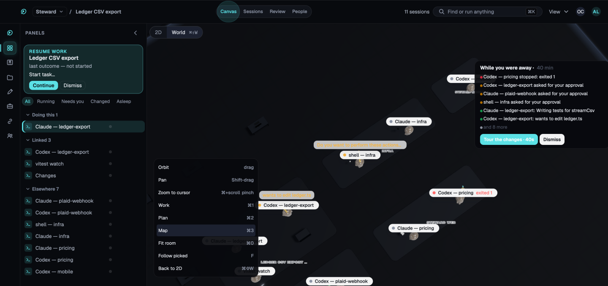
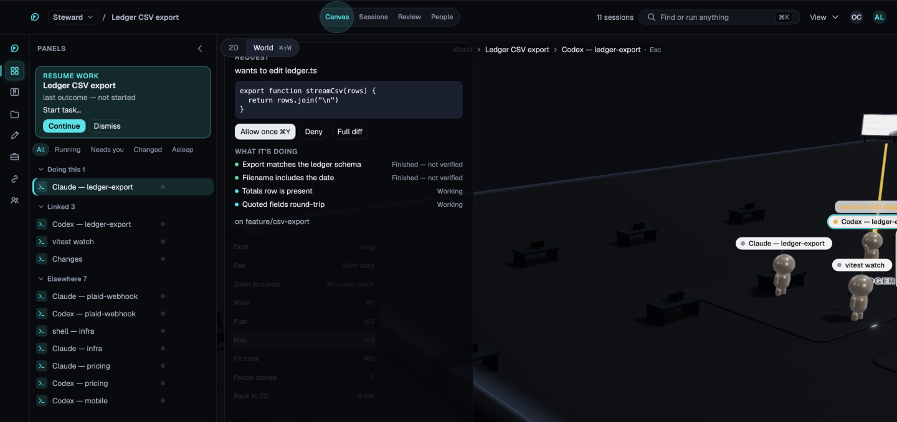

<p align="center">
  
</p>

# Terminal Canvas

<p align="center">
  <strong>Run coding agents side by side. Review every change.</strong><br>
  Claude Code, Codex and plain shells each get a real terminal on one canvas.
  See which one needs you, review what each one changed, and wake up to finished work.
</p>

<p align="center">
  <a href="https://github.com/alexnieves-cs/terminal-canvas/actions/workflows/verify.yml"></a>
  <a href="LICENSE"></a>
  <a href="docs/guide/install.md"></a>
  
</p>

<p align="center">
  <a href="https://alexnieves-cs.github.io/terminal-canvas/demo/"><strong>Live demo</strong></a> ·
  <a href="https://github.com/alexnieves-cs/terminal-canvas/releases/latest"><strong>Download</strong></a> ·
  <a href="https://alexnieves-cs.github.io/terminal-canvas/docs/"><strong>Docs</strong></a> ·
  <a href="https://alexnieves-cs.github.io/terminal-canvas/">Website</a> ·
  <a href="docs/release-notes/6.1.0.md">6.1 release notes</a>
</p>

<p align="center">
  
</p>

<p align="center"><sub>
  The real app. Every still on this page is one of the reference screenshots the visual check
  compares against, painted on a Mac from sample data.
</sub></p>

> **Status: `v6.1.0`.** macOS, Apple Silicon. Free and open source. The release is not signed
> yet, so macOS objects on first launch; [Install](#install) has the fix.

## Why

Coding agents run for minutes or hours. The usual way to run several is a wall of terminal tabs,
and the agent that stopped to ask you something is the one you do not see. Terminal Canvas puts
each agent in a real terminal on a canvas you arrange, and keeps track for you.

## What it does

- **Runs any agent CLI.** Every panel is a real terminal, so `claude`, `codex`, `gemini` or
  your own shell work as they do anywhere else. [Supported agents](docs/guide/agents.md).
- **Tells you who needs you.** A waiting agent lights its panel's edge and the dock count.
  `⌘J` goes to the next one.
- **Reviews each agent's work.** You see what that one agent changed since it started, and you
  commit from the canvas. [Review](docs/guide/review.md).
- **Keeps agents apart.** Each agent can have its own git worktree and branch.
- **Hands work on.** Draw a link between two panels. When the first finishes, the second starts
  with its output.
- **Works overnight.** Give it a list of tasks, and come back to a queue of checked results.
  [Overnight](docs/guide/overnight.md).

The full list is in [docs/features.md](docs/features.md).

## Three ways to use it

**Several agents on one repository.** Start each in its own worktree and arrange them side by
side. When one asks a question, `⌘J` takes you to it.

**One task, start to merge.** Type what you want and pick a repository. The app makes a branch,
starts the agent, and shows you the diff when it is done.

**A night of work.** Queue tasks with **Run tonight**. They run one at a time, pause at your
usage limit, and wait for you in the morning queue.

<p align="center">
  
</p>

<p align="center"><sub>
  <b>The night as a film.</b> The app renders a batch as a 60-second MP4. This clip is that code
  run on a sample night.
</sub></p>

## A look around

<table>
  <tr>
    <td width="50%"><br><b>Sessions.</b> Who needs you, and every agent grouped by task.</td>
    <td width="50%"><br><b>Review.</b> One agent's diff, and the request it is waiting on.</td>
  </tr>
  <tr>
    <td width="50%"><br><b>Find anything.</b> <code>⌘K</code> searches panels, tasks, files and commands.</td>
    <td width="50%"><br><b>The canvas.</b> One task's panels, with the inspector beside them.</td>
  </tr>
  <tr>
    <td width="50%"><br><b>The World.</b> The same layout in 3D, with a catch-up when you return.</td>
    <td width="50%"><br><b>Focus and act.</b> Answer an agent's request from a side sheet.</td>
  </tr>
</table>

## Install

1. Download the `.dmg` from the [latest release](https://github.com/alexnieves-cs/terminal-canvas/releases/latest)
   and drag **Terminal Canvas** to Applications.
2. The release is not signed, so macOS blocks the first launch. Open **System Settings → Privacy
   & Security** and choose **Open Anyway**, or run:

   ```sh
   xattr -dr com.apple.quarantine /Applications/Terminal\ Canvas.app
   ```

   Only do this because you have read the source or trust its author. The app runs whatever
   commands you give it.
3. Install an agent CLI such as `claude` or `codex` and sign in to it once in a terminal.
4. Optional: `brew install tmux`, so agents keep running through a reload or a quit.

To build from source instead:

```sh
git clone https://github.com/alexnieves-cs/terminal-canvas.git
cd terminal-canvas
npm install
npm run dev
```

More in the [install guide](docs/guide/install.md). Then follow [your first task](docs/guide/first-task.md).

## Keyboard

Every canvas shortcut uses `⌘`, because an agent's terminal uses every plain key.

| Keys | What it does |
|---|---|
| `⌘N` | Start a new task |
| `⌘K` | Find or run anything |
| `⌘J` | Go to the next agent that needs you |
| `⌘Y` | Allow the pending request |
| `⌘⇧S` | Open Sessions |
| `⌘/` | Show every shortcut |

The [keyboard guide](docs/guide/keyboard.md) lists them all.

## Docs

| For | Read |
|---|---|
| Using the app | The [user guide](docs/guide/README.md): install, first task, review, overnight, agents, FAQ. |
| Choosing a tool | The [comparison](docs/guide/compare.md) with similar tools. |
| What is in each release | [Release notes](docs/release-notes/). |
| Working on the code | [Development](docs/development.md), [architecture](docs/architecture.md) and [milestones](docs/milestones.md). |

## Verification

`npm run verify` is the whole check: every suite, a typecheck and a build, on a Mac runner for
every pull request. What it cannot prove is listed at the end of
[docs/load-bearing.md](docs/load-bearing.md). [Development](docs/development.md#verification)
says how the suites are organised.

## Contributing

Issues and pull requests are welcome. Start with [CONTRIBUTING.md](CONTRIBUTING.md). Tried the
app or the demo? [Share feedback](https://github.com/alexnieves-cs/terminal-canvas/issues/new?template=feedback.yml);
it is a short form.

## License

[MIT](LICENSE) © 2026 Alex Nieves
