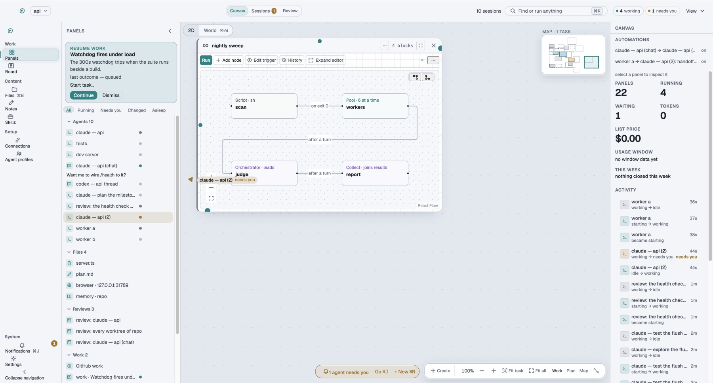

# Terminal Canvas user guide

Terminal Canvas is a Mac app that puts coding agents in real terminals on a canvas you arrange.
It shows you which agent needs you, lets you review what each one changed, and can work through
a list of tasks while you sleep.

## Start here

1. [Install](install.md): download the app and get past the first launch.
2. [Your first task](first-task.md): from an empty canvas to an agent at work.
3. [Review](review.md): see what one agent changed, and commit it.

## Then

- [Keyboard](keyboard.md): every shortcut.
- [Supported agents](agents.md): which CLIs work, and what each one gets.
- [Overnight](overnight.md): hand over a list of tasks and wake up to a queue.
- [FAQ](faq.md): safety, cost, platforms and troubleshooting.
- [Comparison](compare.md): how it differs from similar tools.
- [Getting started](../getting-started.md): a longer walk through workflows, previews, notes and
  sharing a canvas.

Not sure yet? The [live demo](https://alexnieves-cs.github.io/terminal-canvas/demo/) runs in a
browser with scripted agents and nothing to install.

The pictures in this guide are the real app. They are the reference screenshots the project's
visual check compares against, painted on a Mac from sample data, so names like "Steward" and
"ledger-export" are examples.
