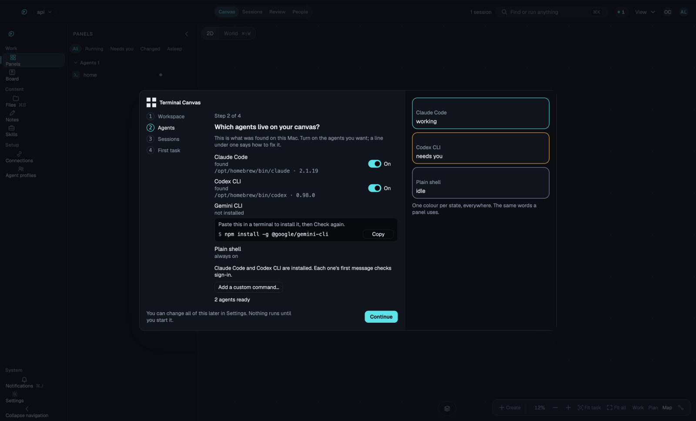
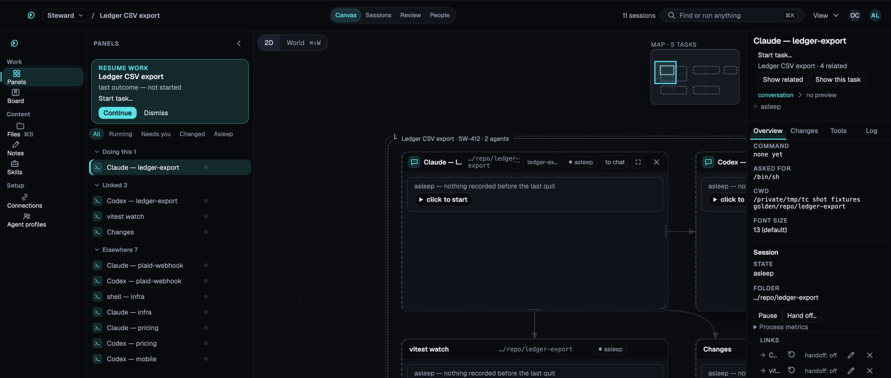
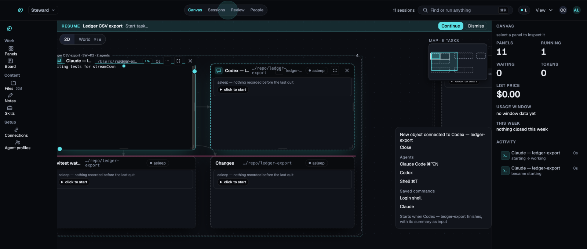
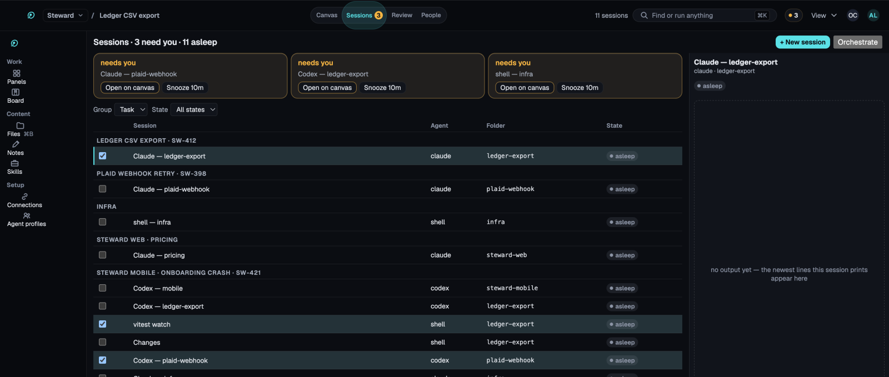
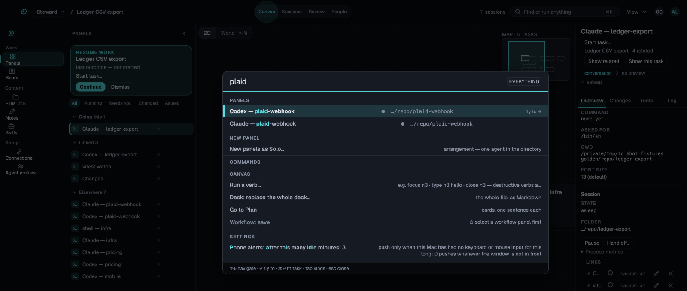

# Your first task

## Start work

On first launch, a short setup shows which agent CLIs it found on your Mac. Turn on the ones you
want as presets.

Then the empty canvas asks two things: what you want to work on, in a plain sentence, and in
which repository. Press **Start work** (`⌘N` asks the same thing later).

Before anything runs, the card says what will happen. Start work then:

- makes a task,
- makes a branch and a git worktree for it, so your own checkout is left alone,
- opens a conversation with the agent in that worktree, with your sentence as its first message.

A folder that is not a git repository is refused by name, with **Chat in this folder instead**
beside it. **Ask without a folder** opens a read-only conversation about nothing on disk.

Anything else you can start (a terminal, a file, a note, a workflow) is under **More ways to
start** and in the palette, `⌘K`.

## Move around

- Pan with a two-finger scroll, or drag the background. Pinch to zoom.
- Drag a panel by its header. Resize it from its edges. Drag on the background to select several.
- `⌘1`, `⌘2` and `⌘3` switch between Work, Plan and Map. Zoomed out, panels become
  cards that keep their name and state.
- `⌘0` fits everything on screen.

## Add a second agent

- `⌘⌥N` starts another agent. `⌘T` starts a shell.
- Drag from a port on a panel's edge to start a connected panel. Set the link to hand off, and
  the second panel starts when the first one finishes, with its output as context.
- For two agents on one repository, use **Claude in a fresh worktree** from the palette. Each
  agent gets its own checkout and branch.

## Notice who needs you

When an agent stops to ask permission or finishes its turn:

- its panel's edge changes colour,
- the dock shows a count,
- macOS posts a notification if the window is behind another one.

Press `⌘J` to go to the next agent that needs you. `⌘Y` allows the pending request.

**Sessions** (`⌘⇧S`) lists every agent with its state, grouped by task.

## Find anything

`⌘K` opens the palette. It searches panels, tasks, files, settings and commands. A row that
cannot run right now stays in the list with the reason beside it.

Next: [review what the agent changed](review.md).
