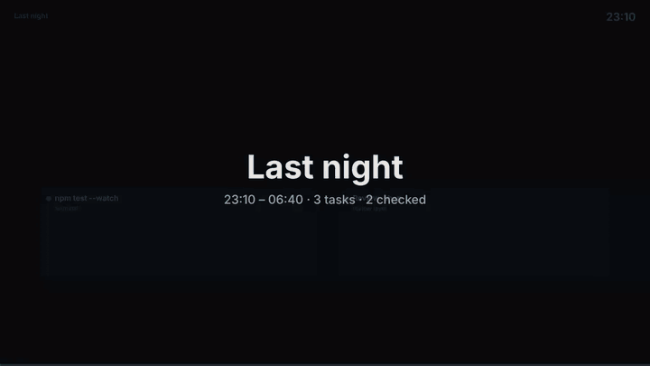

# Overnight

You can hand the app a list of tasks, leave, and come back to a queue of results to review.

The clip is the app's own film code run on a sample night.

## Start a batch

1. Open the tasks you want done. Each one needs a chat panel.
2. Choose **Run tonight** in New task or in the palette (`⌘K`). From a terminal, use `tc tonight`.
3. Leave the Mac on and plugged in.

`tonight stop` ends the batch.

## What happens while you are away

- Tasks run one at a time, in order.
- If you reach your usage limit, the batch pauses. It resumes the same task when the limit
  resets. A task is never marked failed because the account ran out.
- The Mac is kept awake while a batch runs, and only then.
- A task can have a spend ceiling. Work on it stops when the ceiling is reached.
- A task can have a check, such as your test command. See [checked and unchecked](review.md#checked-and-unchecked).

## The morning queue

When you come back, the queue lists each task with one word:

| Word | Meaning |
|---|---|
| **failed** | The check kept failing. These come first. |
| **decide** | The agent stopped on a question for you. |
| **checked** | The check passed. Review it and merge. |
| **review** | There are changes to look at. |
| **unchecked** | The agent said it was done, and nothing checked it. |

Nothing is merged for you. Each result goes through [review](review.md) first.

## The night as a film

**Last night** on the morning queue renders the night as a 60-second MP4. The app draws it from
its own record. Every caption passes the same secret scrubber as any other export.

## Phone alerts

Set an [ntfy](https://ntfy.sh) topic in **Settings → Privacy & export** and subscribe to it in
the free ntfy app. When an agent starts waiting on you and the Mac has been idle for a few
minutes, your phone gets the agent's name and its question. `tc phone-test` sends a test alert.

Answering from the phone (Allow once or Deny) is off by default. Turn on `remote.phoneAnswers`
to use it.

## Sandboxed tasks

A task can run in a throwaway virtual machine that sees only its own worktree. This is off by
default (`vm.lanes`) and needs Apple container, OrbStack or Docker. It has not been confirmed on
a real Mac by hand yet, so treat it as experimental.
