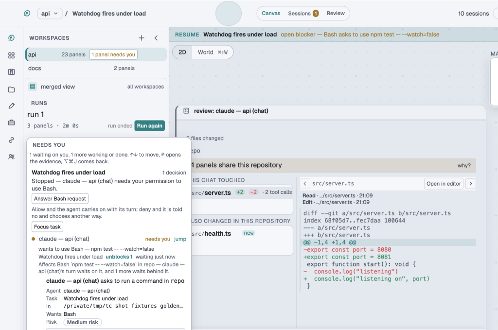

# Review

Every agent's work is reviewed before it reaches your branch. Review is part of the canvas, so
you do not need a separate diff tool.

## What a review shows

When an agent starts, the app takes a snapshot of its working tree. The review compares the tree
now against that snapshot. So you see what that agent changed, and not what was already there.

- **This chat touched** lists the files the agent edited, with added and removed line counts.
- **Also changed in this repository** lists files that changed some other way.
- Click a file to read its diff. **Open in editor** opens it in your editor.

If several panels share one checkout, the review says so, because it cannot tell their changes
apart. Give each agent its own worktree to avoid this. A task from **Start work** already has one.

## Act on it

- **Discard** throws away one file's change.
- **Commit** commits what is left, from the canvas.
- Send a comment back to the agent, and it takes another turn.

## Answer a permission request

An agent that wants to run a command or edit a file stops and asks. The **Needs you** list shows
the request, the task it belongs to and what is waiting behind it.

- Allow it, and the agent carries on with its turn.
- Deny it, and the agent is told no and chooses another way.

`⌘Y` allows the pending request. `⌘⌥Y` allows every pending read at once.

## The Review page

**Review** in the top bar lists everything that came back: tasks an agent finished with changes,
and tasks whose check failed.

## Checked and unchecked

A task can carry a check, which is a command such as your test suite.

- **checked** means the check ran and passed.
- **unchecked** means only the agent said it was done.

The app keeps these two apart everywhere, including in the [morning queue](overnight.md).

## Lessons

A file you discard, or a review comment you send, is kept as a lesson. **Lessons** on the Review
page lists them. Turning lessons into rules for the agent is off until you switch on
`learn.agents` in Settings.
